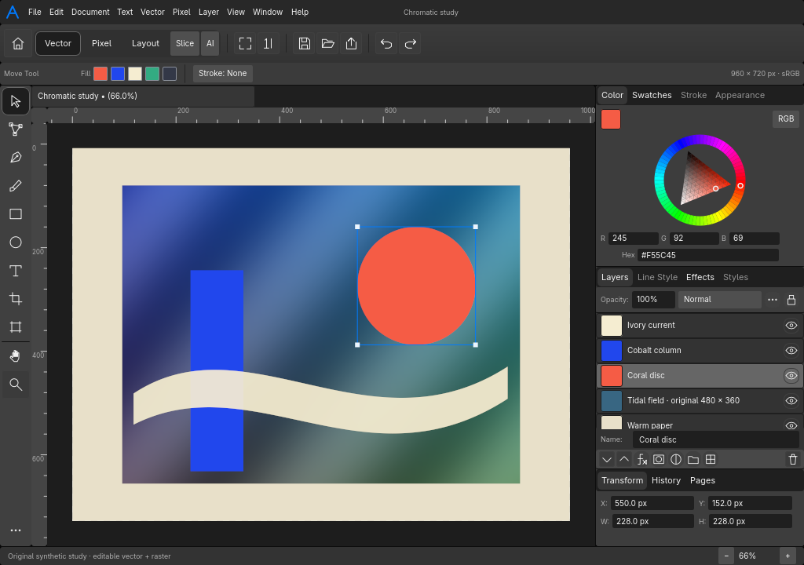

# AFFINT

A native Rust editor for vector, photo and page workflows, using
[Matari UI](https://github.com/Matari-Audio/MUI), winit and wgpu.

AFFINT is an early working editor, not a complete Affinity replacement. Its goal
is a familiar compact interface, immutable originals, atomic reversible edits and
full requested-resolution processing. It is independent of Affinity, Canva and
Adobe, and contains no proprietary implementation or vendor artwork.



## What works

- Filled vector shapes and affine raster layers; move, reorder, rename and hide.
- Editable crop, exposure, opacity and alpha/luminance masks.
- One-edit drawing, movement, opacity and fill gestures with undo/redo.
- Multiple pages, page-scoped editing and captured-page export.
- Atomic editable `.affint` saves and a deliberately limited sRGB PNG workflow.
- Linear-premultiplied F32 rendering and same-device GPU display composition.
- Bounded retained geometry/layer tiles, shared original owners and strict cache
  invalidation. Conservatively validated tile reuse avoids repeating unchanged work.
- Native-density retained camera translation, coherent picking/selection, bounded
  overscan and coalesced camera requests. Zoom awaits required-density pixels.

Text editing, path handles/strokes/booleans, painting, advanced filters, ICC/RAW,
professional layout and Affinity/PSD/AI interchange are not implemented. Document
evaluation remains CPU work; GPU display does not mean GPU document evaluation.
Arbitrary zoom, fractional and curve pan cache reuse remain limited. Dense output
writing/upload still costs work. No world-fastest or full UI-parity claim is made.

See [the capability table](docs/roadmap.md), [architecture](docs/architecture.md),
[render contract](docs/render-contract.md) and [PNG policy](docs/png-policy.md).

## Build and run

Linux is the verified target. The repository pins Rust 1.98.1 for reproducible
verification. Workspace manifests declare Rust 1.95; lower per-crate/minimum
versions have not been independently qualified.
Native use needs a graphical session, the platform's X11/Wayland libraries and a
supported graphics driver. Windows/macOS builds are not qualified.

```sh
git clone https://github.com/DerpcatMusic/AFFINT.git
cd AFFINT
CARGO_TARGET_DIR=target cargo build --locked --release -p affint-app
./target/release/affint-app
```

MUI is pinned to a public source revision. All package versions remain locked.
The editor starts with original synthetic artwork for exploring supported tools.
Open and save native documents through File; Place accepts the documented PNG
subset. Ctrl+Q uses protected close.

## Verification

The retained-renderer/camera increment passes **153 tests plus a renderer doctest**,
formatting, all-target Clippy with warnings denied and the native build. Real
RX6600/Vulkan proofs cover F32 color, source-preserving retained camera display,
same-scene selection, publication and completion-aware retirement. Save/edit/export
smoke passes. These checks establish their stated scope, not complete product parity.
Release observations and exact-output oracles are recorded in
[the retained-work report](docs/performance/retained-work-01.md).

```sh
scripts/verify --label local-check --build-app --jobs 2
./target/debug/affint-app --smoke-test .research/smoke
./target/debug/affint-app --gpu-proof .research/gpu-proof
AFFINT_DIAGNOSTICS=1 ./target/debug/affint-app --interaction-profile .research/profile
```

Run one build/check/test/benchmark process at a time. `scripts/verify` owns an
exclusive lane and retains local logs. Interaction diagnostics record bounded
metadata and write after normal close. GPU readback occurs only in the proof mode.
Private raw research and mirrored evidence are excluded from the public repository.
Research reports distinguish source observations, independent implementation and
unresolved behavior; private evidence paths are not public download links.

## License and contributions

Original AFFINT code, icons, documentation and synthetic artwork are [MIT](LICENSE).
Embedded fonts and dependencies retain their own licenses; see
[LICENSES.md](LICENSES.md) and [native notices](crates/affint-app/NOTICE.md).
Read [CONTRIBUTING.md](CONTRIBUTING.md) and [AGENTS.md](AGENTS.md) before contributing.
