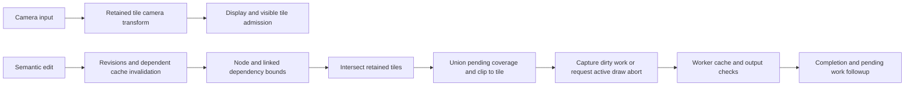

# Installed Affinity retained geometry and invalidation

Status: frozen, bounded source-only round 2, 2026-10-12. This independently worded
specification describes reached binary operations and their limits. Implementors
consume this document and the other sanitized reports, never the raw vendor code.

The inspected pipeline separates **camera motion, source curves, derived node
caches, dependency bounds, pending tile regions and render ownership**. Camera
motion can present retained tiles through a new affine transform. An element edit
can retain its source curves while changing transform revisions, invalidating
dependent state and marking intersecting display tiles. These are concrete seams
for avoiding a fresh whole-document evaluation on every motion event. They do not
prove that every affected tile reuses tessellation, or that every edit evaluates
only one shape. A dirty tile can still require several contributing objects.

No installed Affinity target/helper was executed, and no window or desktop was
launched, focused, captured, given input or closed during this round. No AFFINT
product source, build, test or benchmark was changed or run by this worker.
There is no latency, active-backend, cache-hit-rate or runtime parity claim.

## Evidence scope

Six bounded native analyses reconstructed 52 root records representing 50 distinct
entry addresses in `libpersona.dll`. They imported 89 source-equal code/data slices
totaling 23,875 bytes, including overlap between analyses. All 52 Ghidra calls
reported completion, but three reconstructed records truncate at an unmapped tail
target. One was repaired in a later mapping of the same entry. The final evidence
therefore has complete local pseudocode for 48 distinct entries and complete local
assembly, with an unresolved tail callee, for two more. Decompiler completion is
not proof of complete control-flow or semantic recovery.

Read coverage includes the reconstructed local bodies listed in the ignored
ledger; direct callees and virtual targets are outside that coverage unless listed
separately. Prior round 2 tile evidence and round 1 camera evidence are reused with
explicit read scopes. Candidate export lists and table probes are inventories,
not additional decompiled or understood routines. This is not a whole-codebase
reading claim.

| Installed image | SHA-256 |
|---|---|
| `libpersona.dll` | `285b2b2634029ddb05e7ef436a4da5aefec973362187a88e848b361d22ee1678` |
| `Serif.Interop.Persona.dll`, wheel constants/reused input body | `dcf43441e01dbf3fbe83ccb3e3b3279929d89ad8ea9f10a76745aea6a16219dc` |

Both files are under the owner's installed
`<local Affinity installation>/`.
Exact source offsets, followed branch ranges, code/data hashes, reconstruction
hashes, quality notes and reused evidence are in ignored
`.research/vendor-affinity/retained-view-r2/coverage-ledger.json` and
`artifact-digests.json`. The script verifies each new imported slice against the
installed bytes and their recorded hashes. Mutable Ghidra project/home/temp
directories are excluded from the artifact digest catalog.

## Camera movement retains display work

The source-derived camera behavior is established in
[the camera and tile scheduling report](affinity-view-pipeline-spec.md). A tiled
view maintains a residual camera affine transform separately from its tile
transform. Composing the camera marks/redraws the view and reaches tile updating;
the updater returns while residual scale differs from one beyond its tolerance.
Pure translation can admit entering tiles and remove leaving tiles. Scale changes
can present retained tiles while the managed 100 ms completion timer is restarted,
then rationalize transforms and retile after that callback.

This route is distinct from changing an object's editable geometry or transforms.
The observed display tile coordinate steps are 256, or 512 in another mode. They
are not source-resolution or export limits. The dependency state and requested
quality still govern subsequent exact tile work.

## A transform revision is separate from retained curve content

The transform setters and affine composition path enumerate linked transform
interfaces, advance their transform revision and change their affine coefficients.
The examined bodies do not replace the source curve owner. The revision increment
also reaches a shared derived-cache invalidation helper; revision advancement is
therefore more than a display repaint request.

The direct mutable-curve getter returns the existing counted curve owner when
there is no linked source node. With a linked source, it delegates to that source's
curve interface and retains the returned owner. The direct branch contains no
curve flattening or regeneration. A polygon-curve node delegates to this getter.
Presentation and underlying-contour getters in the examined vector node are
virtual dispatch seams; their names alone do not establish tessellation reuse.

A distinct contour cache has its own retained owner and associated affine state.
Explicit contour-cache invalidation releases that derived owner, resets its
stored affine state and reaches the shared invalidation helper. A corner-cache
invalidation callback reaches that contour invalidation path by a tail jump.
This establishes separately retained source and derived data. The contour cache's
producer, full identity, hit conditions and tessellation relationship were not
recovered here.

The shared helper invalidates seven separate validity categories, under their
respective locks, along an ancestor chain. Its boolean determines whether the
starting object participates or traversal begins at its parent. A subsequent
Node-related branch visits related child chains in seven categories and reaches a
recursive helper. The exact seven category meanings and all relation types remain
unknown. They must not be labeled as seven specific geometry/render caches.

## Semantic edits propagate beyond one object

Transform invalidation enumerates linked transform dependents and obtains each
dependent's invalidation bounds. Transparency, visibility, blend and filter-effect
interfaces have corresponding linked-dependent enumeration. Concrete vector-node
dispatch tables map these calls to their node-specific bound collectors; this
round does not infer those mappings solely from export names.

Transform, blend, visibility and filter-effect collectors ask for an invalidation
owner, fall back to the current node when that result is empty, and collect that
owner's visible bounds. The base parent lookup delegates through the parent rather
than unconditionally returning the immediate parent. The inspected GroupNode and
VectorNode structure tables use that base lookup. Which special parent types
select a broader invalidation owner remains unresolved. Ancestor derived-cache
invalidation is independently established by the shared helper above.

Transform-bound collection also includes text-wrap and text-flow invalidation,
and a story-pin bound when present. Transform-change notification reaches story
pin and spread text-flow/text-wrap paths. A transform can affect layout or linked
content even when its own source curves are unchanged. These paths are evidence
against a blanket policy that only the directly moved object matters.

The vector node's parent-composite decision depends on blend state and, in a
conditional branch, whether the node can be expressed as a vector clip for the
target. A raster enclosure always requires a parent composite in its examined
method. One blend code forces the vector result, but its symbolic meaning was not
resolved and is not assigned a mask/blend label here. This demonstrates that
independently cached child pixels cannot always be composed without broader work.

The base node's `InvalidateRequiresMask` returns false. This does **not** establish
that editable mask changes need no invalidation, or that all subclasses do the
same. Display tile mask updating, editable layer masking and parent clipping must
remain separate concepts. The
[editable mask report](affinity-editable-mask-spec.md) supplies its own bounded
evidence; the complete connection from those edits to these dirty collectors is
still unknown.

The examined move-up command invokes grouped selection visitation and clears the
ordered-selection cache. Visitation handles directional traversal and interface
store/restore around selected nodes. Its actual structural mutation and render
dirty producer were not fully followed. Cache clearing here proves selection
ordering maintenance, not a complete redraw contract for sibling reordering.
Likewise, the delete command's rectangle-extraction wrapper transfers collected
rectangles to the caller, but its rectangle producer and cleanup tail body were
not read. This round does not establish universal old-plus-new dirty coverage.

## Tile dirtiness accumulates independently of active work

The earlier single-view collector intersects transformed spread-associated dirty
coverage with each retained tile. Tiles without overlap do not receive the
examined rectangle-invalidation call. Contributing bounds are combined with a
scale-related margin before the tile consumer is invoked. The indirect spread
context, every flag and complete operation/filter expansion policy remain only
partially resolved.

The tile consumer transforms a supplied region into its normal coordinate system
and, when enabled, a second quality coordinate system. The newly followed integer
rectangle helper forms the bounding union with pending dirty coverage. Its
intersection helper clips the result to the tile extents. Empty input and empty
intersection have explicit handling. This is one accumulated bounding rectangle
per quality route, not proof of a sparse per-pixel region list. Separated edits in
the same tile can consequently include the space between their bounds.

The transform/bounds helper evaluates all rectangle corners, bounds the result,
and has rounding/tolerance branches. Unexamined numeric tail helpers prevent a
complete edge-rounding contract. Sentinel pending state can expand to full tile
extents, and another scale-dependent branch expands bounds. Partial invalidation
is an available path, not a guarantee that every change touches only its smallest
mathematical rectangle.

The consumer marks the tile invalid and pending. When no draw is active and the
tile is eligible, it attempts a draw. Otherwise it requests abort on retained
render targets. Begin refuses hard-stopped, paused, document-less and empty work;
it atomically claims the active-render state and captures clipped normal and
second-quality dirty regions for launch. New invalidation state remains distinct
from those captured regions. Prior request/worker tracing is described in
[the raster and tile report](affinity-raster-tile-spec.md).

This diagram joins established producer/consumer seams. The complete dispatch
from every edit command to the bounds collector is not recovered.

## Render trigger and completion authority have limits

A tile retains the new renderable trigger before releasing the previous trigger,
under the dependency lock. The ordinary setter has a branch that leaves an
existing cache intact when its flag is false; other branches reset the retained
cache aggregate and invalidate. The explicit setter-and-invalidate path resets
that aggregate and requests invalidation. Pointer replacement is not by itself a
complete semantic dependency key.

Prior worker evidence checks the current trigger pointer against the captured
request trigger while replacing one retained cache. A separate abort check occurs
after raster work and before typed output callbacks. Completion considers sampled
abort and tile-invalid state and can attempt another draw after releasing the
active state. These operations support retained dependency identity, cancellation
and pending work followup. They do not establish one atomic end-to-end publication
check against a current immutable document revision. The concrete typed output
completion subclass remains unidentified.

## Removal retains owners until CPU rendering settles

Removing a layer's tiles requests hard abort, clears thread/device assignment,
retains each tile in a separate removal collection, then clears the active tile
list. Purging holds the view structure lock and checks each tile's atomic
active-render state. A rendering tile receives another hard-abort request and
stays retained. An idle tile reaches a virtual cleanup/completion slot, leaves the
removal collection and causes the removal semaphore to be signaled. The waiting
variant repeatedly purges and waits on that semaphore until the collection is
empty.

This is an observed **CPU rendering/owner settlement boundary**. The virtual slot
body and hardware fence were not recovered. Thread/device unassignment changes
assignment state; it does not establish that the GPU finished using an allocation.
Abort acceptance, active CPU rendering ending, object ownership release and GPU
completion are four distinct authorities in this specification.

## Independently designed AFFINT interfaces and correctness requirements

The following are AFFINT design implications, not recovered vendor APIs or a
proprietary algorithm translation:

| Boundary | Independently defined responsibility |
|---|---|
| Source geometry | Retain immutable curve data by semantic content identity; camera movement does not create a new curve owner. |
| Derived geometry | Key transform-sensitive flattening, stroke/contour and bounds by every relevant source, transform and operation input. |
| Dependency invalidation | Reach linked content, ancestors, group composites, editable masks, operations and order dependencies; preserve both old and new affected coverage. |
| Retained tile | Accumulate clipped dirty coverage independently of captured active work; keep unaffected owners reusable. |
| Camera display | Present retained artwork with a transform while tracking precise pending work and the camera used for hit testing. |
| Job publication | Require AFFINT's own document/dependency/view/device identities; reject obsolete results even if cancellation arrived late. |
| Retirement | Keep every owner and admission charge until the actual CPU/GPU completion authority permits release. |

Group isolation, mask coverage, filter halos and sibling ordering need independent
cached-versus-uncached output oracles. A node-only cache identity or its own bounds
cannot establish those invariants. The observed architecture supports incremental
work, but no comparative speedup or AFFINT runtime improvement follows from static
vendor evidence alone.

## Address map and remaining seams

All addresses below refer to preferred installed-image addresses, not a runtime
Wine mapping. Exact followed ranges and hashes are in the ignored ledger.

| Seam | Entry addresses / restricted record |
|---|---|
| Trigger retention/reset | `0x1915f3a40`, `0x1915f3dc0`; `native/lifecycle/` |
| Removed ownership and active state | `0x1910aca60`, `0x1910ad9c0`, `0x1915f1e00`, `0x1915f1e20`; `native/lifecycle/` |
| Thread/device unassignment | `0x1915ef690`; `native/geometry/` |
| Affine editing and revision | `0x191215560`, `0x191215d40`, `0x191215e70`, `0x191214380`; `native/dependencies/`, `native/geometry/` |
| Retained curve getter/delegation | `0x186fc99e0`, `0x1807d53a0`; `native/semantic/`, `native/geometry/` |
| Contour cache and corner tail | `0x180b31b40`, `0x1915701a0`; `native/semantic/`, `native/dependencies/` |
| Seven-category ancestor helper | `0x182d60e90`; `native/semantic/` |
| Linked transform and other dependents | `0x191213d30`, `0x191213e10`, `0x191240330`, `0x1916052f0`, `0x183b7a000`, `0x1858a5bc0`; `native/dependencies/` |
| Bound collectors and parent lookup | `0x187007700`, `0x187007760`, `0x1870077e0`, `0x1870078d0`, `0x1870047c0`, `0x187001190`, `0x187007bb0`, `0x19156fca0`, `0x1870045a0`; `native/semantic/`, `native/cascade/`, `native/dirty-dependency/` |
| Layout notification | `0x18700b150`, `0x18ffa50f0`; `native/semantic/`, `native/cascade/` |
| Parent-composite decisions | `0x19156dae0`, `0x18006aa70`; `native/cascade/` |
| Order visitation/selection cache; delete extraction | `0x186fc38d0`, `0x1835821f0`, `0x18f4f2d40`, `0x18428eb10`; `native/cascade/`, `native/dirty-dependency/` |
| Tile rectangle consumer and draw capture | Prior `round-02/native/persona-expanded/` entries `0x1915f19f0`, `0x1915ef010`, `0x1915f1ea0` |
| Integer union/intersection and transformed bounds | `0x1804838c0`, `0x1803dfb30`, `0x181628b60`; `native/dirty-dependency/` |
| Worker trigger/abort checks | Prior worker `0x1915fb4a0`, selected instruction spans `0x1915fc6b4`–`0x1915fc6bb` and `0x1915fcf2c`–`0x1915fcf39` |
| Verified dependency dispatch | `native/dependency-table-prefixes.json`, `native/semantic-dispatch-probes.json`; neighboring-table probe output is not a complete vtable definition |

The concrete unresolved seams are the seven validity-category identities and
geometry cache producers; special invalidation-owner selection; complete old/new
bounds generation for transform, mask, operation and reordering commands; symbolic
parent-composite conditions; exact edge/halo rounding; typed result-publication
authority; and hardware completion/retirement. These are specific followup targets,
not claims of missing vendor functionality.

The source-only wheel clarification is also recorded in
[the camera report](affinity-view-pipeline-spec.md): capped signed delta uses a
positive coefficient of 0.25 per 120 units and a nonpositive coefficient of 0.2,
with the recovered single/double rounding sequence. Negative -240/-360 events
produce approximately 0.6/0.4 single-precision factors. Exact constant bytes and
hashes are in R2's ignored `native/wheel-constants.json`.
