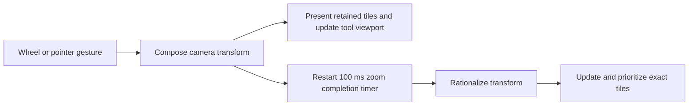

# Installed Affinity camera, tile scheduling and dirty-region findings

Status: bounded source-bound static round 1, 2026-10-12. This is an independently
worded specification, not vendor implementation. Raw code and reconstructed markup
are restricted to ignored `.research/vendor-affinity/ui-reference-r1/`.

## Coverage and authority

The round analyzed 27 distinct native functions in three installed libraries.
All 27 Ghidra decompilations completed. Their plans include exact source addresses,
file offsets, byte digests and followed local branch ranges. Five sequential
analyses imported 89 bounded code/data slices totaling 41,973 bytes. A separate
59-byte local tile-priority comparator was read as branch-followed assembly.
The original binaries remain unchanged. No Affinity target/helper, AFFINT build,
test or benchmark was executed by this worker.

Managed control/resource reconstruction and saved UI preferences supplement the
native input trace. Static evidence establishes reached operations and constants;
it does not establish interactive latency, exact frame cadence, complete cache
identity, thread scheduling, revision freshness or GPU completion.

The principal installed identities are:

| Artifact | SHA-256 |
|---|---|
| `Serif.Interop.Persona.dll` | `dcf43441e01dbf3fbe83ccb3e3b3279929d89ad8ea9f10a76745aea6a16219dc` |
| `libpersona.dll` | `285b2b2634029ddb05e7ef436a4da5aefec973362187a88e848b361d22ee1678` |
| `libaffinity.dll` | `b6e38da9de61c6a395458710a4bc27b6028b6e91498dc12c2d30eec96b414376` |

Native pseudocode has incomplete types and sometimes incorporates a tail-called
function in its output. In particular, the single-view transform's final assembly
instruction jumps to tile updating; its pseudocode also includes that updater.
Those bytes are separately mapped by the updater's own root, not silently counted
as extra independent source understanding.

## Input and camera organization

The main document view is a native child window inside WPF. Managed camera commands
delegate to it, while window messages cross a native dispatch table. Certain pointer
messages leave handling to WPF when another managed element holds capture. The
managed generic zoom/pan widget is separate from this main editor path.

The saved installation has wheel zoom disabled and scrubby zoom enabled. Native
wheel handling compares the wheel-zoom preference with Ctrl state: ordinary wheel
events scroll; Ctrl-wheel zooms. Alt-wheel rotation is disabled in the saved
preferences. These settings are snapshot evidence; runtime input remains a
separate check.

Wheel zoom composes a cursor-centered affine transform into the tiled-view
container, then emits a zoom callback. Delta is capped at ±360 and divided by 120
in single precision. The normalized positive delta is multiplied by 0.25 in
double precision; the nonpositive delta is multiplied by 0.2. That product is
rounded to single precision, added to single-precision 1, then widened for the
affine transform. Thus the real-number event formulas are `1 + delta / 480` for
positive delta and `1 + delta / 600` for negative delta, subject to that rounding
and cap. The factors for +120/+240/+360 are 1.25/1.5/1.75; the negative counterparts
are approximately 0.8/0.6/0.4. Multiple notches in one event use linear event
scaling; the negative branch does not take the reciprocal of the positive factor.
The arithmetic is at `DocumentRenderWindow.OnMouseWheel` address
`0x180e25a28`–`0x180e25aad` in the installed interop image. R2's ignored
`native/wheel-constants.json` records the four exact constant bytes, addresses and
hashes. This is static evidence, not a runtime input measurement.

The scroll path divides signed delta by four with integer truncation toward zero
and selects an axis from Shift/horizontal-wheel state. The bridge then updates
the active tool's device viewport, document/device transform, scale and visibility
options. Native rulers contribute a 20 DIP viewport-origin adjustment.

Pointer panning computes incremental displacement from the current pointer's
distance to the gesture origin minus the previous accumulated displacement.
Its vertical displacement changes sign at the controller seam. Scroll composition
uses translation on the existing tiled view and can hide the tool overlay during
camera movement. The input eligibility checks remain tool-dependent.

Scrubby zoom has a 3.5-unit initial motion threshold. Horizontal travel is normalized
by half the viewport width; normalized travel beyond magnitude one has reduced
gain 0.1. Zoom grows toward four times the gesture's initial zoom on the positive
side and toward one-quarter on the negative side before the outer low-gain region.
The inspected path clamps to a minimum 2 percent and snaps values strictly inside
45–55 percent to 50 and 90–110 percent to 100. These are static controller constants,
not a measured touch/mouse acceleration model.

## Immediate display versus exact tile followup

The managed zoom-start callback restarts a **100 ms** dispatcher timer. It updates
scrollbars, cursor and zoom notifications at the start. When the timer fires,
native zoom completion calls transform rationalization and retiling. A separate
explicit path requests forced retiling.

The single-view transform retains a residual camera transform separately from
the underlying tile transform. It uses two structural locks and marks/redraws the
view, then tail-calls tile updating. The tile updater returns early when either
decomposed residual scale differs from one by more than **1e-6**. This is concrete
evidence for avoiding ordinary new tile generation while scale is transient.
Translation-only changes can still update entering/leaving tiles immediately.

When rationalizing, a force flag or a nontrivial residual linear component triggers
work. The function aborts active tile draws, reorganizes retained view layers,
recomposes transforms and conditionally adjusts translation for pixel alignment.
It then updates tiles, releases the structure lock, purges removed tiles and
requests redraw. Destruction/fences and stale-job cancellation are not proved by
the abort/purge names.

Pixel alignment admits a near-integer effective scale or a near-integer reciprocal
scale, using a 1e-6 comparison threshold. It is therefore a zoom-dependent display
policy, not blanket rounding of editable document geometry.

## Tile prioritization and residency

Tile updating transforms the viewport into tile coordinates, computes candidate
ranges, carries render triggers/solo-node settings into tiles, invalidates newly
needed tiles and removes tiles outside a padded visible range. The tile-coordinate
width is 256 in the ordinary branch and 512 in a distinct mode branch; these are
the inspected display-tile coordinate steps and do not establish the document's
source tile format or every high-resolution buffer's dimensions.

For more than one tile, prioritization pairs each tile with the Euclidean distance
between its center and a supplied point. The updater supplies the transformed
viewport center. A separately read comparator sorts ascending distance, treating
differences within 1e-6 as ties. The view therefore orders center tiles before more
distant tiles at this seam. This does not prove worker completion order.

Invisible-tile removal computes a padded tile range under the current transform.
For an excluded tile, it aborts its draw, retains a reference in the removal
collection, then removes it from the active layer. The removal collection is
separate from the active display set; removal is not evidence of immediate free or
GPU completion. The ownership rules still need their own producer/consumer trace.

## Dirty regions and display cache

Container-wide cache invalidation fans out to every contained view. A spread-level
variant can target one view index or all views. Cache-trigger replacement retains
the new renderable carrier before releasing the old one and distributes it to
the contained views. These facts establish object retention boundaries, not the
complete set of semantic values that identify a cache result.

Single-view logical invalidation holds the structure lock, obtains each retained
tile's logical rectangle, and scans spread-associated dirty rectangles. An indirect
spread/context interface gates applicable entries and supplies their transform.
The routine transforms all rectangle corners, computes intersections against the
tile bounds, combines contributing coverage and adds an inverse-scale-derived
margin before calling the tile's rectangle invalidation seam. An optional flag
also updates that tile's mask. No overlap means the inspected tile path does not
receive an invalidation call. The exact flags, expansion tolerance and indirect
context meaning remain partially inferred.

Display cache updating reads a spread's primary or secondary cached bitmap,
constructs a separate dynamic display buffer at that bitmap's dimensions, obtains
the view's input color profile and dispatches conversion helpers according to
format/mode. It retains source, display buffer and profile carriers through the
conversion path. The helper bodies were not read, so this round does not establish
their full color/math precision, ICC/OCIO equivalence or all format conversions.

## AFFINT implications and limits

These observations support three independent implementation policies: present a
camera transform immediately using retained artwork; schedule exact tile work
after camera settling while retaining explicit pending state; and invalidate only
tiles that can intersect transformed dirty coverage. View-center priority makes
the first arriving precise pixels more useful to the artist. These policies must
be implemented with AFFINT's own revision/view identity, admission/ownership,
cancellation and final-output invariants. They are not vendor code to translate.

Original source pixels, document geometry and saved/exported output remain exact.
Transient display transforms and pending precise pixels are display scheduling,
not permission to reduce source/export dimensions or announce an incomplete frame
as exact. Actual usability and numerical checks must qualify AFFINT independently.

## Retained evidence and next seams

| Record below restricted `ui-reference-r1/` | Actual coverage |
|---|---|
| `native/input-main.*`, `native/input-main/` | Six mixed-bridge camera/input roots |
| `native/tiles-view.*`, `native/tiles-view/` | Five container transform/cache roots |
| `native/tile-algo.*`, `native/tile-algo/` | Seven single-view transform, rationalization, scale, priority and tile/cache update roots |
| `native/pan-camera.*`, `native/pan-camera/` | Six controller pan/scrubby/wheel zoom and ruler scalar roots |
| `native/dirty-rect.*`, `native/dirty-rect/` | Three dirty-region, invisible-tile and pixel-alignment roots |
| `native/tile-priority-comparator.{asm.txt,json}` | Complete reachable local comparator assembly with both exits; not Ghidra-decompiled |
| `managed/DocumentView.cs`, prior `../round-03/managed/DocumentRenderControl.ilspy.cs` | Document-host delegation and selected callback/timer/notification sections |
| `preferences/Settings/{ToolsPreferences,UserInterfacePreferences,Schemes}.xml` | Saved input/display choices |

The next bounded targets are the tile rectangle-invalidating consumer's region
accumulation, the retained removal collection's completion fence, and the direct
format-conversion callees reached by display-cache updating. Geometry and filter
kernels still require their own per-operation investigation; module/symbol
inventory alone does not establish their algorithms. Earlier sanitized history,
raster ownership and editable-mask reports remain separately scoped evidence.
